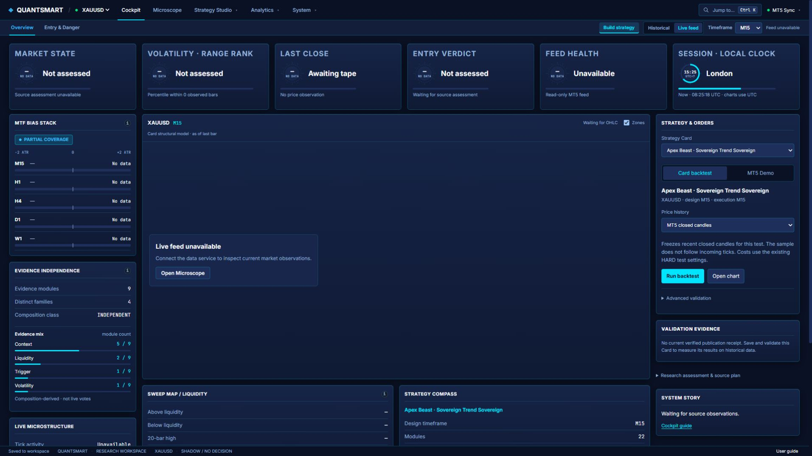

# QUANTSMART

Local strategy design and validation workspace for quantitative research.

QUANTSMART is a local-first research environment for turning trading ideas into explicit, testable strategies. It gives traders and researchers a structured workspace to build custom logic, combine reusable modules, replay historical market data, and evaluate whether an idea is worth pursuing under real validation conditions.

Instead of relying on intuition or isolated chart screenshots, users can assemble strategy components into Strategy Cards, compare outcomes across time windows, and inspect the evidence behind each decision. The workflow is built around clarity, repeatability, and research discipline.

Users can:
- build custom strategies from reusable building blocks
- combine indicators, filters, triggers, and exits into strategy cards
- replay historical market data and compare performance across periods
- validate ideas with structured backtests and multi-window analysis
- design role-based strategy ensembles instead of testing only a single idea
- keep their research local and traceable on their own machine

QUANTSMART is designed for people who want to move from idea to evidence:
- define the logic
- test it against historical data
- review the results in context
- refine the strategy with clear evidence

It is focused on research quality, not hype. The platform helps users create, compare, and validate trading logic in a controlled environment, with optional MT5 connectivity for market inspection when needed.



[Explore all 17 workspaces](docs/PRODUCT_TOUR.md) · [Get started](#quick-start) · [Connect MT5](#connect-xm--another-mt5-broker) · [Security](SECURITY.md)

See the [Custom Module walkthrough](docs/CUSTOM_MODULES.md) for a visual guide to building and inspecting custom strategy components.

## What you can build

- **Strategy experiments:** assemble primitives, indicators, context filters, triggers
  and simulated exits into a versioned Card.
- **Custom quantitative algorithms:** define reusable modules and formula-driven
  experiments, inspect their wiring, and combine Cards into role-based ensembles.
- **Measured validation:** run backtests with stated costs, review OOS and holdout
  coverage, inspect component ablations, and keep source-linked receipts.
- **Market inspection:** explore historical OHLC, chart regions, multi-timeframe
  structure, data-quality events and an optional MT5 tick stream.

Start with a hypothesis, test it against a declared dataset, and review its limitations
before changing the design. Built-in templates are editable starting points; they do
not carry proven performance. Missing inputs remain unavailable.

**License:** Apache-2.0 for the distributed application source. See [LICENSE](LICENSE)
and [NOTICE](NOTICE). Research runs never place trades. Optional manual execution
is restricted to MT5 Demo accounts and requires a reviewed ticket.

## Quick start

Download this source release or clone its GitHub repository, open a terminal in
the repository root, and run:

```sh
npm run mfe
```

On Windows, double-click `start.bat` for the same launcher.

Prerequisites: Node.js 20.19 or newer and npm. Internet access is needed for the
first dependency install. For MT5 data on Windows, also install 64-bit Python
3.11+ and your broker's MT5 desktop terminal.

The launcher installs the frontend, creates an isolated Python environment when
needed, installs the optional bridge, creates a safe .env from .env.example,
starts both local services, waits for readiness and opens http://localhost:5190.
Ctrl+C stops the processes started by that launcher. Existing unrelated services
are never killed. Later starts reuse the installed dependencies.

The connector uses `.venv-mfe`, separate from any research `.venv`. Its interpreter
must pass a runtime check; a leftover executable pointing to removed Python is
not accepted as a working environment. Existing research environments are preserved.

macOS/Linux, missing Python or a failed optional bridge installation continue in
historical mode. No MetaTrader5 native package is installed on macOS/Linux.

```sh
npm run mfe -- --historical       # no terminal bridge
npm run mfe -- --production       # build and serve the bundled frontend/runtime
npm run mfe -- --no-browser       # keep browser opening manual
npm run mfe -- --port 5195 --bridge-port 8795
npm run mfe:check                 # read-only setup report
```

## Connect XM / another MT5 broker

1. Open the broker's MT5 desktop application and sign in there normally.
2. Start QUANTSMART with `npm run mfe` on the same Windows machine. Use the root
   launcher so the frontend and authenticated MT5 bridge start together; running
   `tools/productServer.mjs` alone does not start the connector.
3. Click **MT5 Offline → Auto-Attach Running MT5**. Inspect the detected broker,
   account ID, Demo/Real type, balance and equity before using Live feed.

QUANTSMART's Auto-Attach does not ask for a password. The official SDK can discover a
terminal automatically and use the account saved there. It may launch that
terminal when needed; it does not guarantee the most recently focused terminal.
When several MT5 installations exist, use **Advanced connection** and enter the
full path to the intended `terminal64.exe`. Optional login/password/server fields
are available when you intentionally want to switch that terminal's account.
QUANTSMART never saves the password. [SDK initialization documentation](https://www.mql5.com/en/docs/python_metatrader5/mt5initialize_py)

The bridge scans the connected broker's symbol catalog. For XAUUSD it prioritizes
XAUUSD, GOLD, GOLD#, XAUUSDm, XAUUSD.a, XAUUSD.pro and GOLDmicro, then compatible
suffix variants such as GOLD.i#. Choose a different detected symbol in the
connection dialog if required. The selected symbol is enabled in Market Watch.
A changed terminal/account clears cached data and the previous mapping.

If the terminal emits broker wall-clock fields instead of UTC, configure
`MFE_MT5_SERVER_TIMEZONE` in your local `.env` and restart the launcher. This defaults
to `UTC`. The XM Global installation verified here uses `Europe/Athens`, with
GMT+2 winter and GMT+3 summer. Check your broker's clock before choosing a zone;
do not copy another broker's setting. The bridge converts candles to UTC using
historical DST rules and translates UTC history requests back to the server clock.

Broker access, installed history, market hours, suffixes and account permissions
vary. A stale feed is marked as stale. No candle, account balance or entry score
is invented when a source is absent. The connector provides prices and observed
EMA/ATR measurements; it does not fabricate advisory verdicts or a Trade Plan.

Live charts use a separate server-sent event stream. The bridge reads terminal
tick history in 100 ms batches with millisecond/ordinal cursors, then pushes real
Bid/Ask ticks and the terminal's forming candle. Chart rendering may combine ticks
in the same batch. It does not interpolate or invent price movement. Cockpit's
price and tick counter use this stream; research diagnostics continue to consume
closed candles. Hidden tabs suspend their subscription, and disconnected feeds
show a waiting/reconnecting state. Catch-up reads are bounded at 8,192 rows per
batch; an unprogressable backlog reports an error rather than a false live state.

## Card controls and optional manual Demo tickets

In Cockpit or Strategy Lab, select a saved Card and choose **Card backtest**.
Choose local history or a frozen sample of MT5 closed candles, then **Run backtest**.
Progress, cancellation and saved evidence stay beside that Card. **Open chart**
opens its market view. Full multi-window validation remains under Advanced validation.

Manual Demo execution is opt-in. Set `MFE_ENABLE_MANUAL_DEMO=true` in the local
`.env` and restart the launcher. Choose **MT5 Demo**, verify the account, enter
volume/direction, and review the broker-checked ticket. Only **Confirm Demo BUY/SELL**
submits it. Each position has **Review close**, followed by a separate confirmation.
Real/contest/unknown accounts are rejected. Research runs never call execution.
QUANTSMART does not change the terminal's Algo Trading or external Python API settings.
If a response is unknown, check MT5 before creating another request.

## Historical research without MT5

No private or broker-licensed market histories are bundled. Open **Microscope**,
choose **CSV**, and import your own OHLC file. Existing chart/history tools handle
source selection, chronological replay and research validation. For dataset-backed
research jobs, place authorized files named `ohlc_<SYMBOL>_<TF>.json` in
`mfe_ux_lab/cockpit/public/data/sim/`, with an object containing a `bars` array.
Each bar has `t` (UTC ISO timestamp), `o`, `h`, `l`, and `c`; use actual source data.

A fresh release with no imported dataset shows a clear unavailable-data state.
It starts successfully and does not substitute demonstration market results.

## Local privacy

All application endpoints bind to loopback. Browser requests use one local origin;
the MT5 process requires an ephemeral internal token. Passwords are not written
to browser storage, .env, local workspaces, exports or logs. MT5 itself handles
broker authentication. Read [SECURITY.md](SECURITY.md) for the boundary and limits.
`.env.example` contains ports/mode only. Keep actual .env and user data private.

## Development and verification

The default launcher uses Vite locally. `--production` runs the built frontend,
bundled research worker and durable workspace server. Python and JavaScript tests
use isolated fixtures; fixture prices are never shipped as market history.

```sh
npm run test:mfe
npm --prefix mfe_ux_lab/cockpit run typecheck
npm --prefix mfe_ux_lab/cockpit run build
```

The HTTP research tests under `tools/test-*-product.mjs` additionally require an
authorized local historical dataset. They are not a promise of live readiness.
Python API tests use `httpx`; install `requirements-dev.txt` into the virtual
environment before testing on a clean machine. The test runner automatically uses
that same `.venv-mfe`, so it does not rely on globally installed Python packages.
On Windows: `.venv-mfe\Scripts\python.exe -m pip install -r requirements-dev.txt`.
On macOS/Linux, create `.venv-mfe` with Python 3.11+ for development tests and use
`.venv-mfe/bin/python -m pip install -r requirements-dev.txt`.

## Prepare a public source release

This working checkout may also contain private research. Do not upload it wholesale.

```sh
npm run package:mfe
```

The exporter follows the application's runtime **and type-only** source imports,
adds only approved scripts/docs/tests, rejects private paths and obvious embedded
credentials, and writes a separate source directory, ZIP and SHA-256 manifest in
`release_artifacts/`. It omits node_modules, .venv-mfe, .env, workspaces, account data,
market histories and archives. Review that directory and its manifest, then create
your public repository from it. The command does not upload or publish anything.
