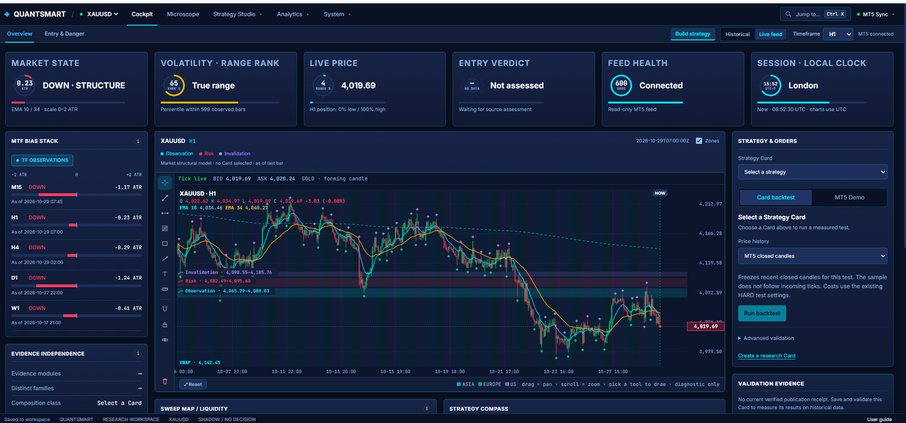
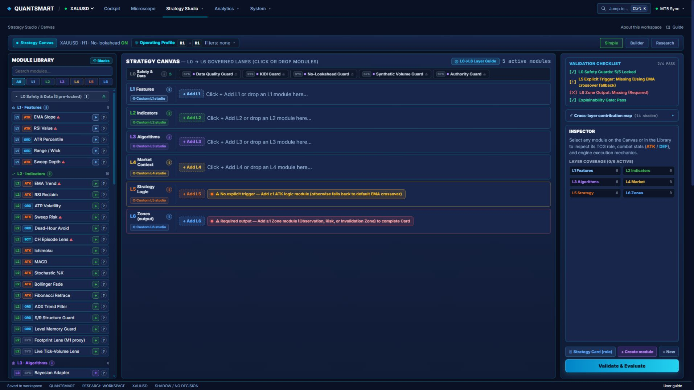
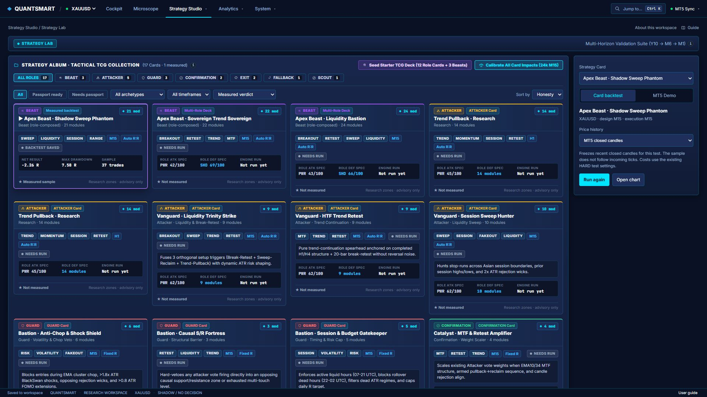

# QUANTSMART

**Build a strategy you can explain. Test it on data you can inspect.**

A trading idea is easy to describe. Turning it into precise rules—and understanding
what happened when those rules were tested—takes more work.

QUANTSMART brings that process into one local-first research workspace. Start with a feature or
formula, assemble it into a Strategy Card, then replay the price history and inspect
the results. The visual editors expose the calculations; the research tools keep the
dataset, costs and validation windows attached to the experiment.



*Cockpit: the supplied full-screen capture shows actual MT5 prices, six telemetry
gauges, timeframe observations and structural reference zones. Entry assessment and
Card evidence remain unavailable until their respective sources exist. [Open the
full-resolution image](docs/screenshots/cockpit-overview.png).*

[Get started](#quick-start) · [Explore the 17 workspaces](docs/PRODUCT_TOUR.md) ·
[Build custom modules](docs/CUSTOM_MODULES.md) · [Video tutorials](docs/TUTORIALS.md) · [Connect MT5](#connect-xm--another-mt5-broker)

## Make the rules your own

Build a candle measurement from primitive blocks, combine indicators into a formula,
or add context and strategy logic in Canvas. Inspect the connections and intermediate
values before saving a component to your library. Templates give you somewhere to
start; your definitions determine the experiment. You can also combine Cards into
role-based ensembles and inspect how their members contribute.



[See the Custom Module walkthrough](docs/CUSTOM_MODULES.md) for a worked feature-graph
example and formula inspection in Coordinate Lab.

## Understand the result, trade by trade

A backtest total is only the beginning. Microscope lets you inspect the price action
around individual observations. Strategy Lab keeps the Card's composition and saved
results together; Compatibility Map shows which historical, out-of-sample and holdout
windows have actually been tested.



Change a hypothesis, run it again, and compare the evidence. Review sample size,
execution costs and fill assumptions alongside the result. A valid graph or a positive
backtest does not establish future performance.

## Use your own data

Import authorized OHLC history for research, or connect an installed MT5 terminal on
Windows to inspect broker prices and tick updates. Historical replay remains available
without MT5. The source release includes no account credentials, private workspace or
market-history files; your local installation supplies those inputs.

QUANTSMART is open source under **Apache-2.0**. Research jobs never place broker
orders. An optional, separately enabled manual ticket workflow supports MT5 **Demo**
accounts with review and confirmation. Real accounts cannot use that execution path.
See [verification and limits](docs/VERIFICATION.md), [LICENSE](LICENSE) and
[SECURITY.md](SECURITY.md).

## Quick start

Windows download: [current portable preview, default port 5090](https://github.com/Jokejoker-designer/QUANTSMART/releases/download/v1.2.0-rc.5/QUANTSMART-1.2.0-rc.5-windows-x64.zip). Historical release assets retain their original behavior; use this build for the 5090 default. CSV file-chooser import, chart opening and custom L1–L6 workflows are covered in the [verification record](docs/LAYER_VALIDATION.md).

### Requirements

- Node.js 22.12 or newer and npm
- Optional for MT5 on Windows: Python 3.11+ 64-bit
- Installed MetaTrader 5 terminal if you want live broker data
- Historical research works without Python / MT5 using CSV or local data files

### 1) Clone and install

```bash
git clone https://github.com/Jokejoker-designer/QUANTSMART.git
cd QUANTSMART
npm install
```

If you are using Windows and want the setup script to prepare the project for you, run:

```bash
npm run setup -- --historical
```

This step creates `.env` from `.env.example` if needed, installs the project deps,
builds the app once, and prepares the local runtime.

### 2) Run QUANTSMART locally

```bash
npm run mfe:doctor
npm start
```

Normal source and portable startup use port **5090**. If it is occupied, startup reports the conflict and preserves the existing process. There is no automatic alternate-port search. Only an explicit `--port` or `MFE_PORT` override changes it.

The app opens:

```text
http://localhost:5090/
```

Useful commands:

```bash
npm run mfe -- --historical       # historical/research mode
npm run mfe -- --production       # production build + served runtime
npm run mfe -- --dev --historical # explicit development mode
npm run mfe -- --no-browser       # do not auto-open browser
npm run mfe -- --port 5090 --bridge-port 8791
npm run mfe:check                 # read-only environment check
npm run mfe:doctor -- --json --offline
npm run test:public               # public tests without private dataset or Python
```

### 3) MT5 setup (Windows only)

Install Python 3.11+ 64-bit and your broker's MT5 desktop terminal. Then run:

```bash
npm run setup -- --mt5
npm run mfe -- --mt5
```

Open your broker MT5 terminal and sign in. In the app, choose **MT5 Offline →
Auto-Attach Running MT5**.

If you have multiple MT5 installations, use **Advanced connection** and select the
exact `terminal64.exe` path. The launcher keeps the connector in an isolated
`.venv-mfe` environment and does not overwrite an existing research virtualenv.

### 4) Development workflow

```bash
npm run setup -- --historical --dev-deps
npm run mfe -- --dev --historical
npm run test:mfe
npm --prefix mfe_ux_lab/cockpit run typecheck
npm --prefix mfe_ux_lab/cockpit run build
```

### 5) Optional manual Demo tickets

If you want manual MT5 Demo trading support:

```bash
# in your local .env
MFE_ENABLE_MANUAL_DEMO=true
```

Restart the launcher afterward. Only Demo accounts are allowed for this feature.
Research runs never place orders automatically.

## Connect XM / another MT5 broker

1. Open the broker's MT5 desktop application and sign in there normally.
2. Start QUANTSMART with `npm run mfe` on the same Windows machine. Use the root
   launcher so the frontend and authenticated MT5 bridge start together; running
   `tools/productServer.mjs` alone does not start the connector.
3. Click **MT5 Offline → Auto-Attach Running MT5**. Inspect the detected broker,
   account ID, Demo/Real type, balance and equity before using Live feed.

QUANTSMART's Auto-Attach does not ask for a password. The official SDK can discover a
terminal automatically and use the account saved there. It may launch that
terminal when needed; it does not guarantee the most recently focused terminal.
When several MT5 installations exist, use **Advanced connection** and enter the
full path to the intended `terminal64.exe`. Optional login/password/server fields
are available when you intentionally want to switch that terminal's account.
QUANTSMART never saves the password. [SDK initialization documentation](https://www.mql5.com/en/docs/python_metatrader5/mt5initialize_py)

The bridge scans the connected broker's symbol catalog. For XAUUSD it prioritizes
XAUUSD, GOLD, GOLD#, XAUUSDm, XAUUSD.a, XAUUSD.pro and GOLDmicro, then compatible
suffix variants such as GOLD.i#. Choose a different detected symbol in the
connection dialog if required. The selected symbol is enabled in Market Watch.
A changed terminal/account clears cached data and the previous mapping.

If the terminal emits broker wall-clock fields instead of UTC, configure
`MFE_MT5_SERVER_TIMEZONE` in your local `.env` and restart the launcher. This defaults
to `UTC`. The XM Global installation verified here uses `Europe/Athens`, with
GMT+2 winter and GMT+3 summer. Check your broker's clock before choosing a zone;
do not copy another broker's setting. The bridge converts candles to UTC using
historical DST rules and translates UTC history requests back to the server clock.

Broker access, installed history, market hours, suffixes and account permissions
vary. A stale feed is marked as stale. No candle, account balance or entry score
is invented when a source is absent. The connector provides prices and observed
EMA/ATR measurements; it does not fabricate advisory verdicts or a Trade Plan.

Live charts use a separate server-sent event stream. The bridge reads terminal
tick history in 100 ms batches with millisecond/ordinal cursors, then pushes real
Bid/Ask ticks and the terminal's forming candle. Chart rendering may combine ticks
in the same batch. It does not interpolate or invent price movement. Cockpit's
price and tick counter use this stream; research diagnostics continue to consume
closed candles. Hidden tabs suspend their subscription, and disconnected feeds
show a waiting/reconnecting state. Catch-up reads are bounded at 8,192 rows per
batch; an unprogressable backlog reports an error rather than a false live state.

## Card controls and optional manual Demo tickets

In Cockpit or Strategy Lab, select a saved Card and choose **Card backtest**.
Choose local history or a frozen sample of MT5 closed candles, then **Run backtest**.
Progress, cancellation and saved evidence stay beside that Card. **Open chart**
opens its market view. Full multi-window validation remains under Advanced validation.

Manual Demo execution is opt-in. Set `MFE_ENABLE_MANUAL_DEMO=true` in the local
`.env` and restart the launcher. Choose **MT5 Demo**, verify the account, enter
volume/direction, and review the broker-checked ticket. Only **Confirm Demo BUY/SELL**
submits it. Each position has **Review close**, followed by a separate confirmation.
Real/contest/unknown accounts are rejected. Research runs never call execution.
QUANTSMART does not change the terminal's Algo Trading or external Python API settings.
If a response is unknown, check MT5 before creating another request.

## Historical research without MT5

No private or broker-licensed market histories are bundled. Open **Microscope**,
choose **CSV**, and import your own OHLC file. Existing chart/history tools handle
source selection, chronological replay and research validation. For dataset-backed
research jobs, place authorized files named `ohlc_<SYMBOL>_<TF>.json` in
`mfe_ux_lab/cockpit/public/data/sim/`, with an object containing a `bars` array.
Each bar has `t` (UTC ISO timestamp), `o`, `h`, `l`, and `c`; use actual source data.

A fresh release with no imported dataset shows a clear unavailable-data state.
It starts successfully and does not substitute demonstration market results.

## Local privacy

All application endpoints bind to loopback. Browser requests use one local origin;
the MT5 process requires an ephemeral internal token. Passwords are not written
to browser storage, .env, local workspaces, exports or logs. MT5 itself handles
broker authentication. Read [SECURITY.md](SECURITY.md) for the boundary and limits.
`.env.example` contains ports/mode only. Keep actual .env and user data private.

## Development and verification

The default launcher runs the built frontend,
bundled research worker and durable workspace server. Use `--dev` for Vite. Python and JavaScript tests
use isolated fixtures; fixture prices are never shipped as market history.

```sh
npm run test:mfe
npm --prefix mfe_ux_lab/cockpit run typecheck
npm --prefix mfe_ux_lab/cockpit run build
```

The HTTP research tests under `tools/test-*-product.mjs` additionally require an
authorized local historical dataset. They are not a promise of live readiness.
Python API tests use `httpx`; install `requirements-dev.txt` into the virtual
environment before testing on a clean machine. The test runner automatically uses
that same `.venv-mfe`, so it does not rely on globally installed Python packages.
On Windows: `.venv-mfe\Scripts\python.exe -m pip install -r requirements-dev.txt`.
On macOS/Linux, create `.venv-mfe` with Python 3.11+ for development tests and use
`.venv-mfe/bin/python -m pip install -r requirements-dev.txt`.

## Prepare a public source release

This working checkout may also contain private research. Do not upload it wholesale.

```sh
npm run package:mfe
```

The exporter follows the application's runtime **and type-only** source imports,
adds only approved scripts/docs/tests, rejects private paths and obvious embedded
credentials, and writes a separate source directory, ZIP and SHA-256 manifest in
`release_artifacts/`. It omits node_modules, .venv-mfe, .env, workspaces, account data,
market histories and archives. Review that directory and its manifest, then create
your public repository from it. The command does not upload or publish anything.

## Quantitative methodology audit

The [methodology audit](docs/QUANT_METHODOLOGY_AUDIT.md) documents reproduced gap-fill and custom-ablation defects, their regression tests, causal measurement checks, and the observed search-triage workflow used to validate the system.

### Entry chronology corrections in 1.1.2

The [follow-up audit](docs/QUANT_CHRONOLOGY_AUDIT.md) reproduces and fixes next-open ATR/Auto R:R look-ahead, missed exits in the intrabar entry candle, and tick-exact labels inferred from metadata. Versions 1.1.0 and 1.1.1 contain these defects. Rerun earlier experiments with the corrected engine. OHLC and M1 results remain approximate; no profitable edge or tick-exact execution is certified.

## Durable CSV research and matched controls

Import historical prices in the [CSV workflow](docs/CSV_IMPORT.md), review strict validation and reopen local datasets after restart. The same stored bars feed chart aggregation and supported Card runs. The [1.2.0 validation record](docs/CSV_RESEARCH_VALIDATION.md) documents actual market-CSV checks, stop-floor/ambiguity/gap corrections and the original acceptance boundary. The [layer verification update](docs/LAYER_VALIDATION.md) records the subsequent browser import and custom-module checks. Matched entry/exit controls are descriptive and support an explicit native-module subset; they do not certify a profitable edge.

Current downloadable preview: [1.2.0-rc.3](https://github.com/Jokejoker-designer/QUANTSMART/releases/tag/v1.2.0-rc.5). Default URL: **http://localhost:5090/**. CSV file-chooser acceptance and custom-layer workflows were exercised on the built preview. See the [verification scope](docs/LAYER_VALIDATION.md) for remaining limits.

## Inspect decision and outcome evidence

In Microscope, select a saved CSV and Strategy Card, then open **Decision & outcome evidence**. Build a local journal to link observed engine signals, policy blocks, modeled fills and completed trades. Saved reports reopen after restart and include source, definition and engine hashes. No-entry and open observations retain null outcomes.

The journal covers observed canonical signals on 61–5,000 design bars. It does not invent structural-thesis identity, missing veto events, exact excursions or calibrated probabilities. See the [Drive integration assessment](docs/DRIVE_INTEGRATION_AUDIT.md) for the accepted changes, deferred algorithms and verification limits.
