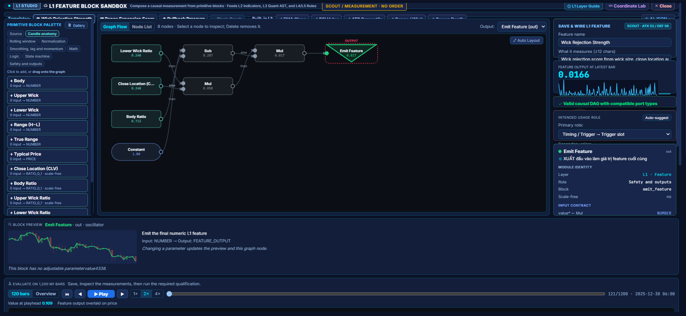

# Build your own quantitative modules

QUANTSMART's custom studios let you describe the calculations behind a strategy,
inspect intermediate values and check how the pieces connect. Open **Strategy
Studio → Canvas** and choose a **Custom L1–L6 studio** beside the corresponding lane.

## Feature graphs: L1

Combine price inputs, candle anatomy, rolling windows, normalization, arithmetic
and stateful blocks into a numeric feature. The graph shows typed ports, connections
and intermediate values. Its inspector explains the selected operation, while the
replay panel lets you examine the feature on a declared price tape.

This example builds **Wick Rejection Strength**:

```text
lower_wick_ratio × close_location × (1 − body_ratio)
```

It measures a candle's geometry. The calculation alone does not establish that it
predicts future returns.



*Full-screen development capture supplied by the project owner. The original image
contains one legacy Vietnamese inspector sentence; the current source explanation
is in English. The graph and measurements are reproduced without alteration.*

## Indicators, algorithms and strategy wiring

Canvas exposes separate authoring lanes for features, indicators, algorithms,
market context, strategy logic and zone output. Use the relevant studio to build
a component, save its definition, and inspect how it contributes to a Card.
Typed connections and dependency checks help identify missing inputs; an editable
component is not automatically an engine-supported or validated strategy.


## Inspect formulas in Coordinate Lab

Use Coordinate Lab to examine a saved formula through curves, surfaces, heatmaps
and slices. Check the selected inputs and fixed-variable assumptions. Geometry,
smoothness and sensitivity describe the formula; they do not prove a trading edge.
Opening the workspace without a saved formula shows an explicitly labeled example.


## From a module to an experiment

1. Start from a small template and identify what the output measures.
2. Change the graph or parameters and inspect the intermediate values.
3. Validate the dependencies and role, then save the component.
4. Assemble it into a Card and run a measured test against your authorized history.
5. Review costs, fill assumptions, sample size and chronological validation coverage.

Saving a definition, passing a graph check and obtaining a profitable backtest are
different milestones. Research runs remain separate from optional manual MT5 Demo
tickets.

Return to the [product tour](PRODUCT_TOUR.md) or [installation guide](../README.md).
