# QUANTSMART product tour

QUANTSMART brings strategy design, market inspection and measured validation into
one local workspace. Use the five navigation groups or press **Ctrl+K** (**Cmd+K** on
macOS) to jump to any of the 17 screens below.

These are screenshots of the running application, captured on October 29, 2026.
The owner-supplied full-screen images preserve their displayed source state: the
Cockpit is connected to MT5; the Chart & Replay capture uses historical fallback.
Screens that require a missing source show that state explicitly. Example designs
and historical results illustrate a workflow; they are not performance guarantees.
Broker credentials, account identifiers and balances are excluded from this tour.

## Cockpit

### 1. Overview

The three-column Cockpit combines a price chart with six telemetry gauges,
multi-timeframe observations, data-quality diagnostics and Strategy Card controls.
Switch between historical data and a connected live feed, inspect the source time,
and run a selected Card without leaving the market view. Range rank and EMA gap are
descriptive measurements. A missing entry assessment remains unassessed.

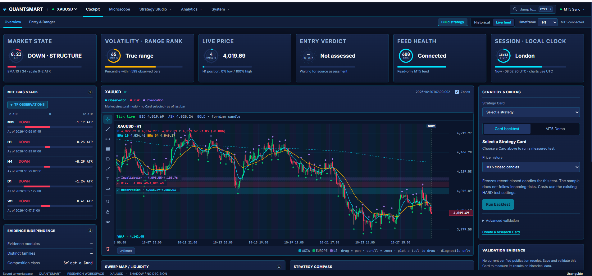

### 2. Entry & Danger

Inspect the entry assessment and danger observations supplied by the current source.
Supporting evidence and measurement availability stay visible. The MT5
price connector does not invent a trading verdict, so this screen can correctly show
an unavailable assessment even while prices are connected.

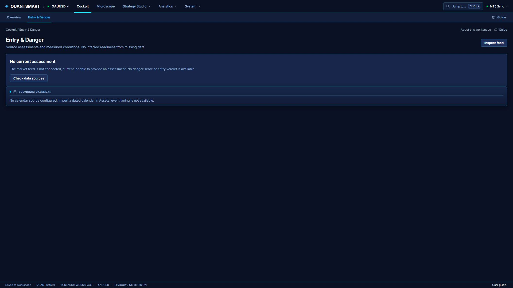

## Microscope

### 3. Chart & Replay

Examine price action, import your own CSV, and replay a selected Card against
chronological history. Compare the design, execution and chart timeframes, inspect
individual events, and review long-history, OOS and holdout windows. Replay uses
modeled execution; check the recorded source, costs and fill assumptions.

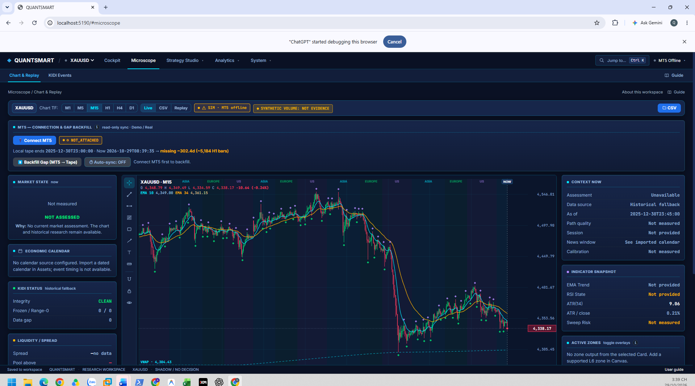

### 4. KIDI Events

Review observations such as flat feeds and zero-range candles on the selected tape.
Use the event list and source timestamps to investigate data quality before interpreting a
strategy result. No events means none were detected by these checks, rather than
a certification that every aspect of the dataset is correct.

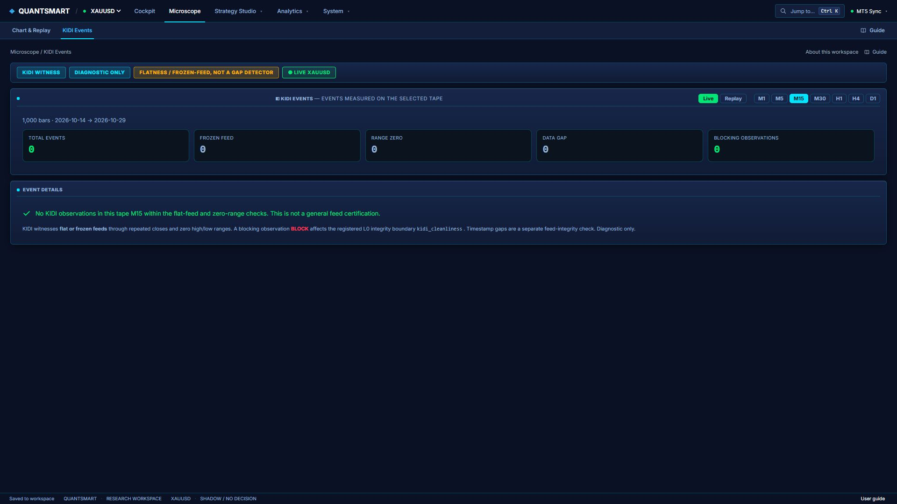

## Strategy Studio

### 5. Playbook

Explore dated research collections, avoidance observations and market-instability
episodes. When compatible source data exists, compare current observations with
historical environments. Historical exports stay separate from today's feed;
unavailable collections are identified rather than replaced with sample research.

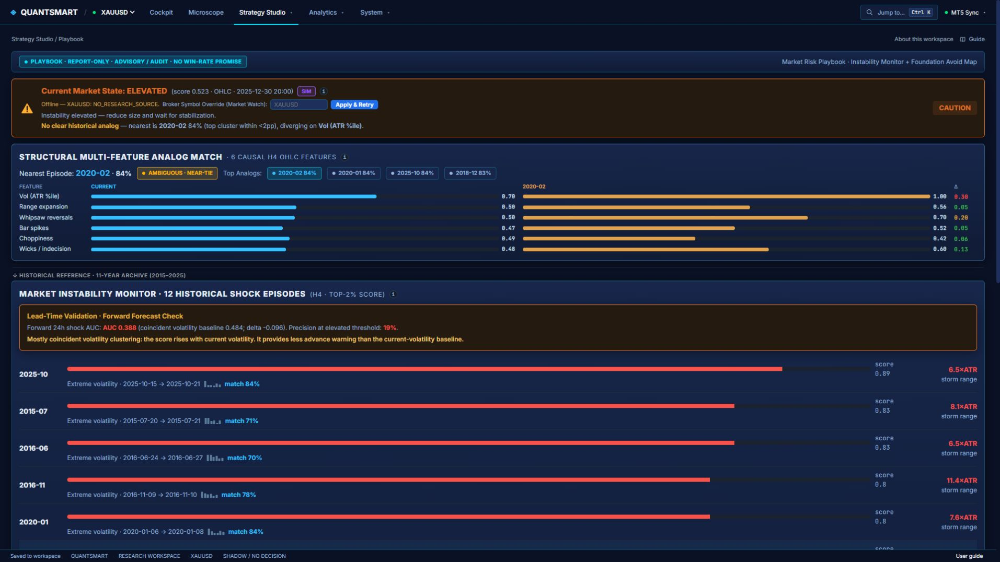

### 6. Strategy Lab

Browse the Strategy Album, select a Card, inspect its module composition and review
saved validation evidence. Run or cancel an owned backtest from the adjacent controls,
then compare the result with the Card's current configuration. Changed designs make
older evidence stale; a Card's name alone does not establish that it was tested.

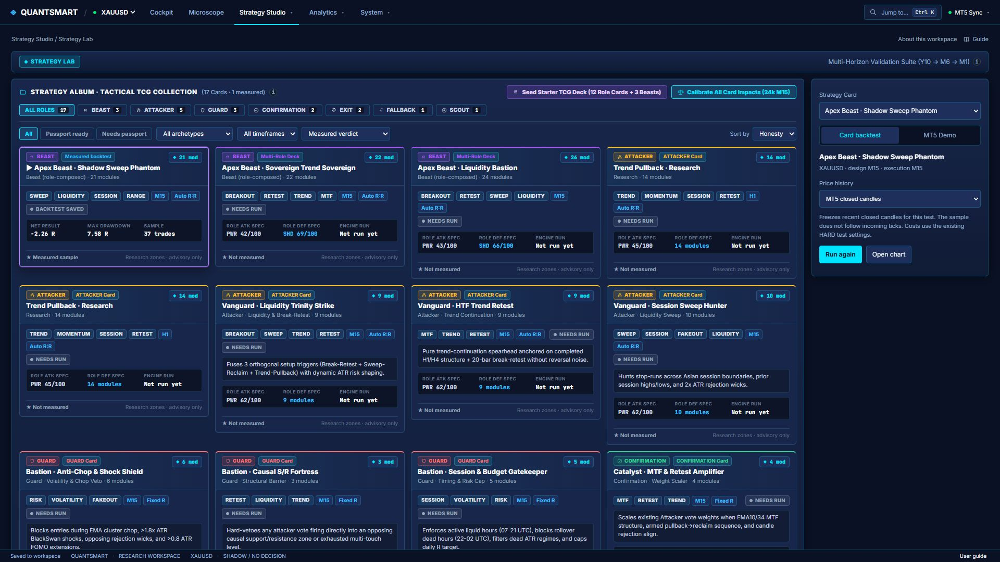

### 7. Canvas

Build your own quantitative strategy from reusable components. The module library,
composition lanes and inspector expose dependencies, roles and wiring. Name and save
a Card, validate its composition, and send it through the measured publication
workflow. Imported or example designs remain drafts until their checks succeed.

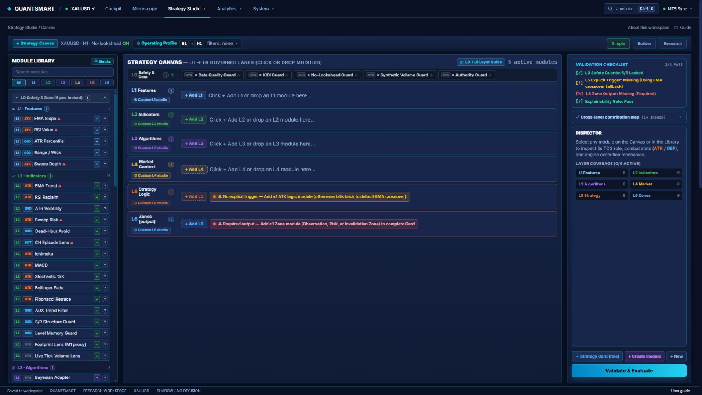

### 8. Blocks & Modules

Inspect primitive blocks, engine modules and custom compositions. Search the library,
compare roles and examine a component's mechanism before adding it to a strategy.
Module descriptions and impact warnings help distinguish a proposed hypothesis from
a contribution that has actually been measured in a combined strategy.

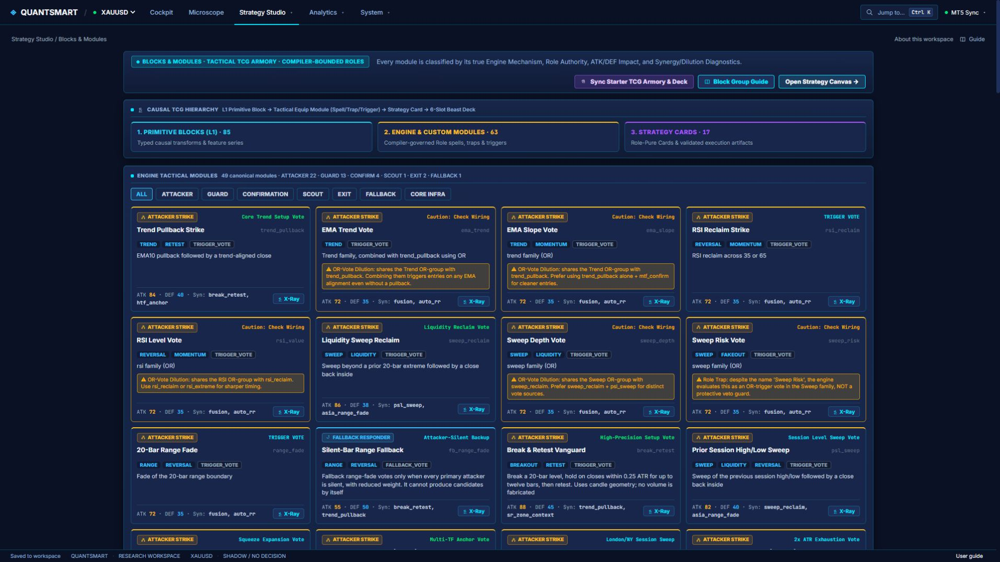

### 9. Beast

Compose role-based Card ensembles, inspect member lineage and compare simulated
matchups. The workspace also exposes environment-routing experiments and editable
starter compositions. A template or compatibility label is a research starting point;
its members and current definition must match the evidence being reviewed.

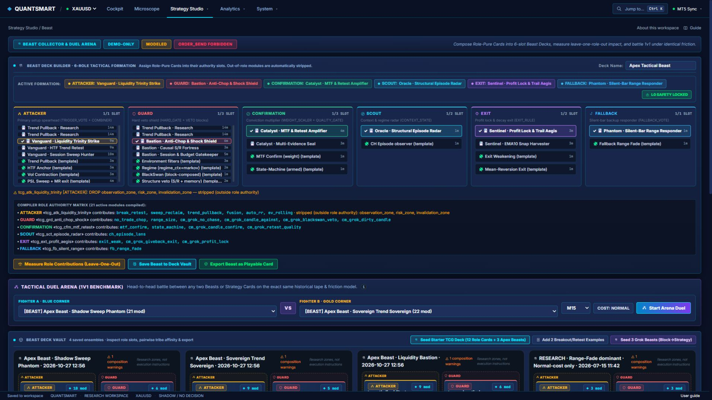

### 10. Coordinate Lab

Explore mathematical expressions through curves, heatmaps, slices and 3D surfaces.
Inspect modeled geometry before turning an idea into a reusable component. The
built-in formula example is labeled as an example; visual structure in a formula
plot is not evidence of predictive market performance.

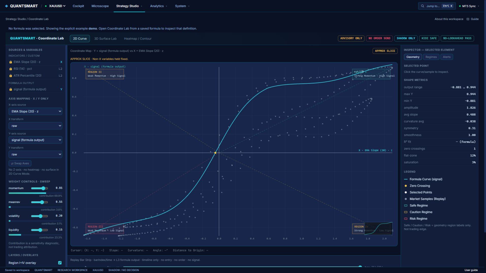

## Analytics

### 11. Weekly Audit

Review validation receipts created during the last seven days, including the actual
historical range and verification state of each run. A separate broker report can
read closed-deal statistics when available. Historical backtest returns are never
presented as this week's account returns.

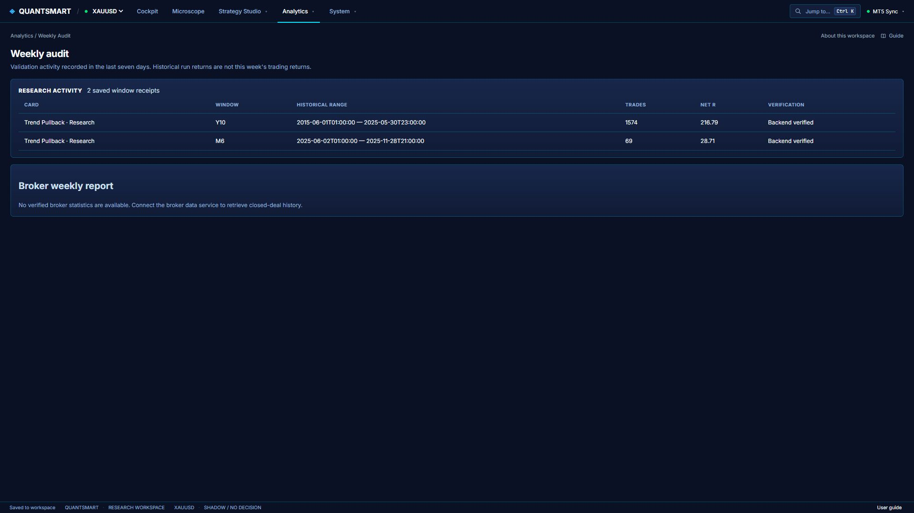

### 12. Compatibility Map

Compare the current Card library's validation coverage across long-history, six-month
OOS and one-month holdout windows. Identify unrun, stale or unverified evidence and
open a Card for closer inspection. Coverage describes recorded research; it does
not promise that the Card will fit a future market regime.

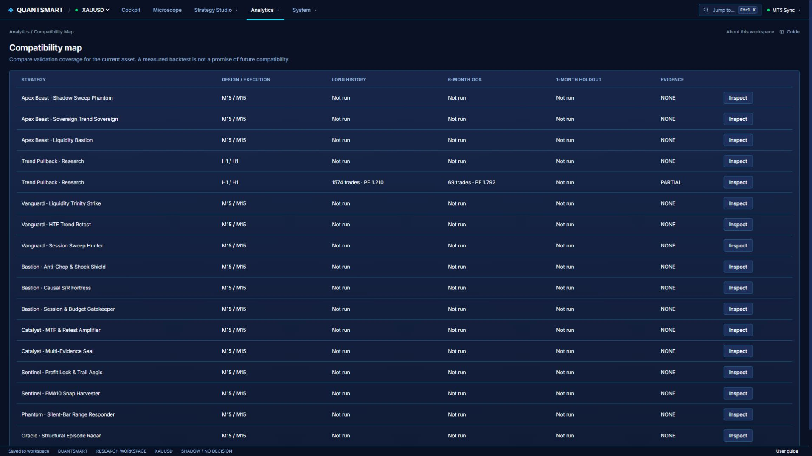

### 13. Assets

Check which symbols and dated datasets are available to the workspace. Configure
authorized sources and inspect missing history before running an experiment. An
economic calendar requires an imported dated source; the application does not
generate a demonstration news countdown when none exists.

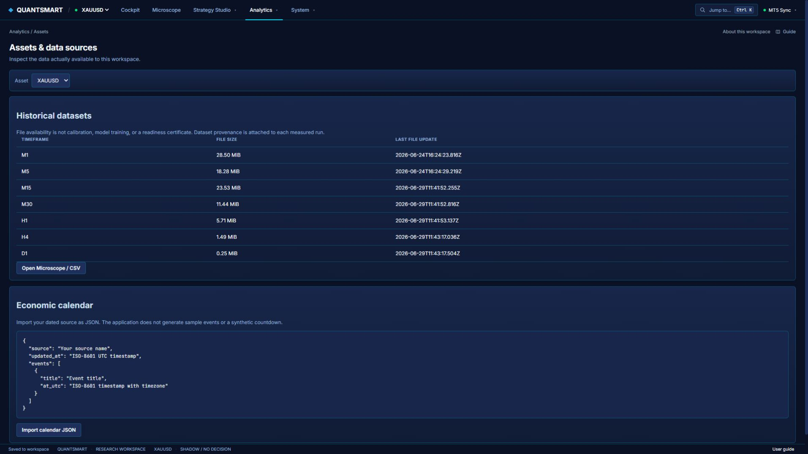

## System

### 14. Hidden Coefficients

Audit configuration coefficients, their provenance and their calibration status.
Use numeric controls to edit a Shadow profile and distinguish configuration,
documented source constants and user overrides. Saving a profile changes the
research configuration; it does not authorize live tuning or trading.

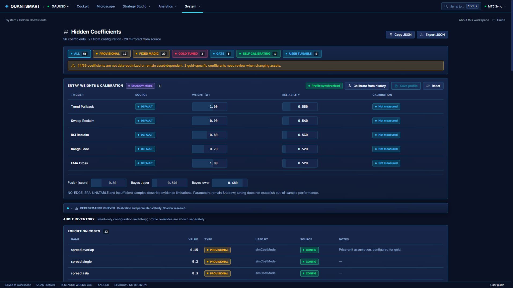

### 15. Governance

Inspect research-service health, workspace revision and engine identity. Review the
research boundary and explicitly load independent historical archives when needed.
A responding research service establishes availability, rather than broker
connectivity, current market data or live readiness.

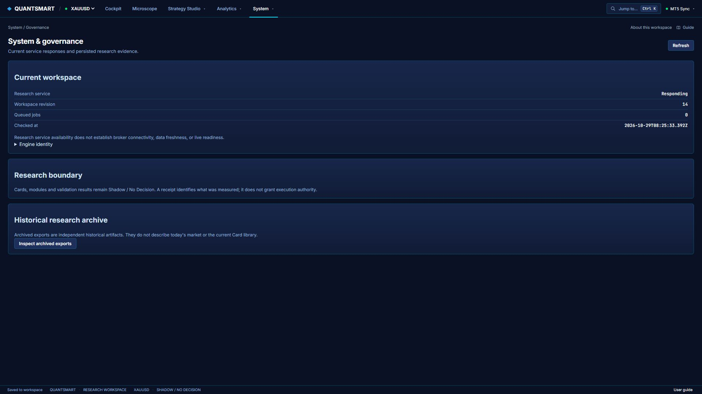

### 16. Debugger

Inspect actual durable-workspace, research-engine or market-feed responses and
surface source errors directly. This is useful for tracing an unavailable panel
back to its API response. The screenshot uses the research-engine view so it does
not expose personal workspace payloads or broker account details.

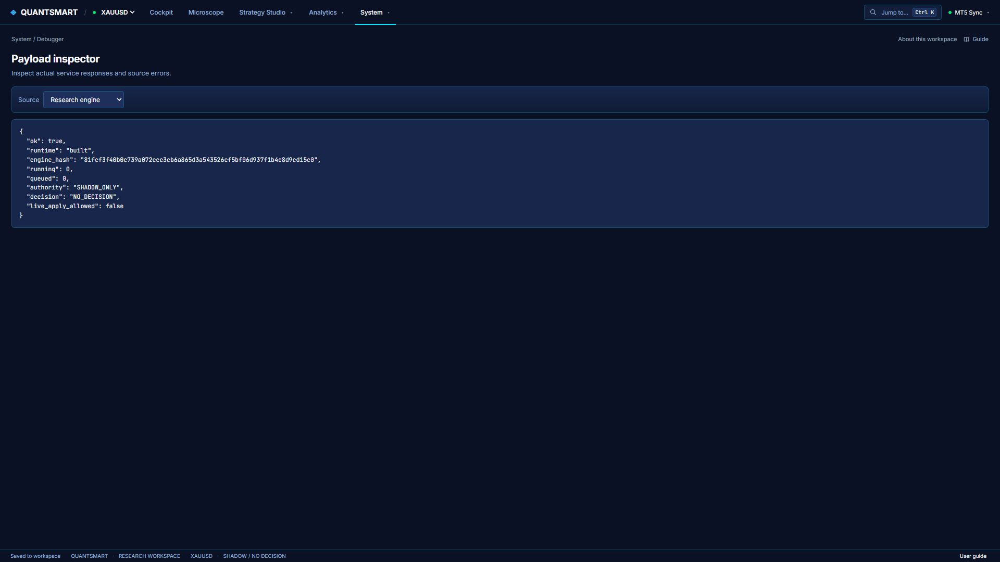

### 17. Guide

Follow the getting-started workflow, find instructions by task, or search the
glossary for terms such as OOS, profit factor, MAE/MFE and receipts. The guide covers
data import, MT5 attachment, Card creation, validation and optional manual Demo
tickets. Research jobs remain separate from manual execution.

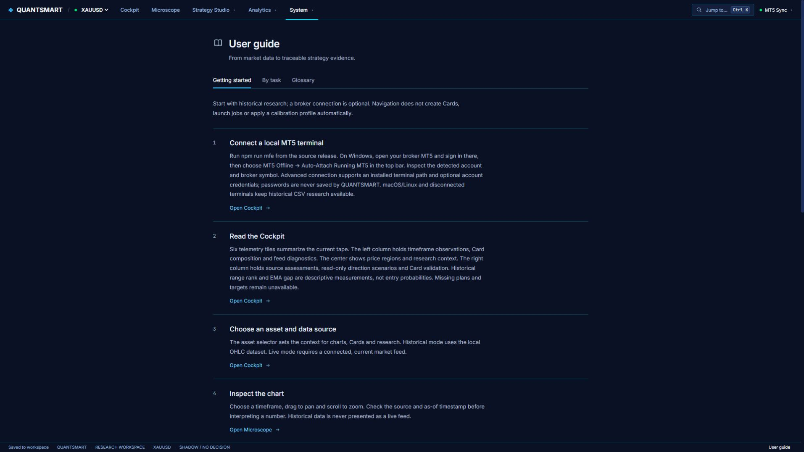

## Suggested first experiment

For a closer look at the authoring workflow, open the illustrated
[Custom Module walkthrough](CUSTOM_MODULES.md).

1. Launch QUANTSMART and import a historical dataset you are authorized to use.
2. Open Canvas, assemble a small Card and inspect its dependencies.
3. Save and validate the Card, then run its backtest in Strategy Lab.
4. Replay individual observations in Microscope and compare validation coverage.
5. Change one hypothesis at a time and retain the source-linked receipts.

See the [README](../README.md) for installation, MT5 setup and the distinction
between research runs and optional manually confirmed Demo tickets.
